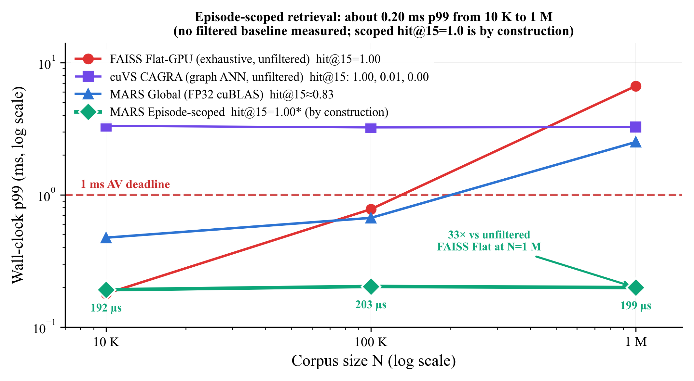
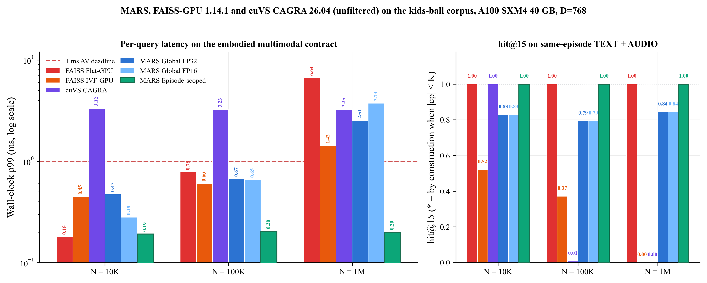
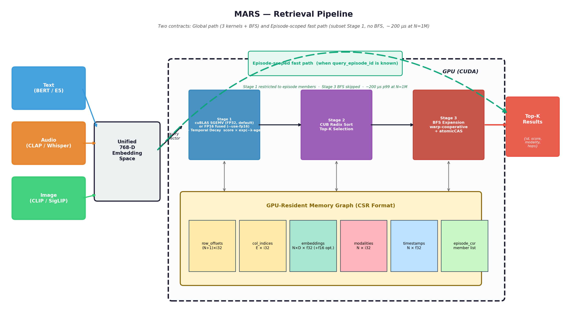

A ball rolls into the road from behind a parked van. The camera sees only the ball. But 600 ms earlier the microphones picked up children's voices from the same direction, and if that memory can be found now, it raises the prior that a child will follow.

A perception stack usually knows where to look for that memory. It has a track id, a dialogue session, an AR room or a robot sub-task, and the answer almost always sits inside that *episode*. GPU vector-search libraries such as FAISS and cuVS rank by similarity over the whole index, and the application adds scope and recency on top, with an ID filter or by post-processing on the host. [MARS](https://github.com/antonellof/MARS) (Memory for Autonomous Real-Time Systems) puts episode scope, temporal decay and an optional cross-modal graph traversal into one GPU-side query call.

**[Paper (PDF)](https://www.fratepietro.com/papers/MARS/main.pdf)** · **[Zenodo](https://doi.org/10.5281/zenodo.24622392)** (DOI 10.5281/zenodo.24622392) · **[Code](https://github.com/antonellof/MARS)**

## What the paper claims

- Episode-scoped retrieval is fast and nearly flat in N. With an episode id, the similarity stage covers only that episode's members, so the work drops from Θ(N·D) to Θ(|episode|·D). On one A100 it runs at 0.17 to 0.20 ms p99 from 10K to 1M memories.
- That is a latency result. The synthetic benchmark has 10-node episodes and K=15, so a scoped search returns the whole episode and its hit rate is 1.0 by construction.
- The fair comparison is still missing. A filtered library search (FAISS with `IDSelector`, CAGRA filtered search) does the same restricted work, and I have not measured it yet. A a per-episode ring buffer with one small SGEMV is faster than MARS on the episode-only case.
- Without an episode id, MARS is slower than FAISS. On random embeddings the global path costs 1.5 to 1.7 times FAISS Flat up to 20K memories and matches it at 50K.
- The graph has no measured benefit yet. Removing the cross-modal bridges, the hubs, or the whole graph changes neither recall nor cross-modal diversity at N ≤ 50K, and on the episode benchmark the BFS re-ranking lowers the hit rate of the global path.

## Episode-scoped against global retrieval

A100 SXM4 40 GB, kids-ball benchmark, paired probes:

| N | Global p99 | Episode-scoped p99 | Ratio | Global hit@15 |
|---|-----------:|-------------------:|:-----:|--------------:|
| 10K  | 0.349 ms | 0.165 ms | 2.1× | 0.83 |
| 50K  | 0.462 ms | 0.172 ms | 2.7× | 0.88 |
| 100K | 0.551 ms | 0.174 ms | 3.2× | 0.79 |
| 1M   | 2.561 ms | 0.197 ms | 13×  | 0.84 |


*The scoped path stays near 0.2 ms because it scans ten vectors whatever N is. No filtered baseline is plotted; I have not measured one yet.*

At ten vectors the memory-bandwidth term is negligible, so most of the 0.2 ms is launch, copy and synchronization overhead. The scoped path only applies when the episode is known before the query: per-track re-identification in a car, a voice session, an AR room, a robot sub-task.

## Unfiltered FAISS and cuVS on the same benchmark

The probe is an IMAGE vector, and a hit needs a same-episode TEXT and AUDIO vector in the top 15. Every row except the last is unfiltered.

| System | 10K p99 / hit@15 | 100K p99 / hit@15 | 1M p99 / hit@15 |
|--------|----------------:|-----------------:|---------------:|
| FAISS Flat-GPU (exhaustive) | 0.18 ms / 1.00 | 0.78 ms / 1.00 | 6.64 ms / 1.00 |
| FAISS IVF-GPU (nprobe=64)   | 0.45 ms / 0.52 | 0.60 ms / 0.37 | 1.42 ms / 0.00 |
| cuVS CAGRA (graph_degree=64) | 3.32 ms / 1.00 | 3.23 ms / 0.01 | 3.25 ms / 0.00 |
| MARS global (FP32 cuBLAS)   | 0.47 ms / 0.83 | 0.67 ms / 0.79 | 2.51 ms / 0.84 |
| MARS global (FP16 fused)    | 0.28 ms / 0.83 | 0.66 ms / 0.79 | 3.73 ms / 0.84 |
| MARS episode-scoped         | 0.19 ms / 1.00* | 0.20 ms / 1.00* | 0.20 ms / 1.00* |

\* By construction.



The scoped path is 33 times faster than an unfiltered exhaustive scan at 1M. That is the price a stack pays when it has no episode filter. It says nothing about a stack that has one.

Unfiltered IVF and CAGRA lose the episode at 100K and above. This failure mode is known, and filtered search exists to fix it. One detail is new to me: at 1M the IVF index still recovers 75% of the exact top 96 while finding none of the episode. My guess is that k-means splits this corpus along a direction shared by all nodes in the same template slot, so the lists it probes hold same-slot vectors from other episodes. I have not inspected the partitions to confirm it.

MARS global is slower than FAISS Flat and finds the episode less often, even though both scan every vector. The likely cause is the BFS score rule. A graph neighbour of the top seed inherits about 0.55 of its score, which beats the 0.19 to 0.45 cosine of a true episode member, and graph edges are not chosen by similarity. Running the global path with BFS off would test this.

## The corpus is synthetic

Each kids-ball episode has three IMAGE, four AUDIO and three TEXT vectors. Same-episode cosine is about 0.32, and cross-episode cosine stays below 0.27, so the episode members are almost always the probe's nearest neighbours. The benchmark tests whether a method can find a ten-vector cluster among a million distractors. It does not test the harder case in the opening story, where the useful memory is less similar than the irrelevant ones.

Two more limits apply. Timestamps rise steadily through the corpus, so episode and recency are perfectly correlated and decay partly does the work of the scope. And real CLIP or CLAP embeddings look nothing like this geometry. A run on real encoder outputs is the experiment the paper most lacks.

## How it works



Embeddings, modality tags and timestamps live in GPU memory as nodes of a CSR graph. A global query runs four kernels with no per-query allocation:

1. cuBLAS `Sgemv` for similarity against all N vectors.
2. A decay kernel that applies `score × exp(-λ·age)` before selection.
3. CUB radix sort for top-K.
4. A warp-cooperative BFS over the graph, scoring discovered nodes by `max(parent · δ_prop, sim · α_bfs)`.

The episode-scoped path restricts step 1 to the episode's member range and skips step 4.

The graph (I call it a Neural Shortcut Network, though nothing in it is learned) is a Watts-Strogatz small-world graph plus cross-modal bridges: every node gets one edge to a node of each other modality. That guarantees a one-hop BFS reaches every modality. It does not make the reached nodes relevant, and an ablation in the paper finds they do not change the results.

A hand-written FP16 kernel beats cuBLAS by 41% at 10K memories and loses by 49% at 1M. The build defaults to cuBLAS.

## Temporal decay

Recency is part of relevance for a tracking query, and MARS ranks by `similarity × exp(-λ·age)` before selecting the top K. In a simulated AV scene (200 tracked objects, 9,000 memories), ranking by cosine alone left 49% of the top 10 more than five seconds old and only 22% inside the two-second tracking window. Applying the same decay score to a FAISS shortlist raised that to 91% and removed stale results. It also lowered object recall from 1.00 to 0.94, because in 6% of queries no detection of the queried object stayed in the top 10. That run measures the score, not the MARS kernel, and pushing the scenario through MARS itself is on the list below.

## Deadlines

Four demonstrators meet their p99 budgets with no misses on an A100 PCIe, using the earlier custom-kernel version of the pipeline:

| Workload | Rate | Memories | Budget | p99 |
|----------|------|---------:|-------:|----:|
| AV perception  | 60 Hz  |  2,400 | 1 ms  | 0.87 ms |
| Humanoid robot | 1 kHz  |  6,000 | 1 ms  | 0.76 ms |
| AR/VR spatial  | 90 Hz  | 20,000 | 5 ms  | 1.56 ms |
| Voice agent    | 30 Hz  |  3,000 | 20 ms | 0.88 ms |

They also pass on an RTX 5060 Ti, at 0.29 to 0.67 ms. All of these are single-query numbers. A car issues one retrieval per tracked object per frame, and 200 queries at 0.26 ms each would take three times a 60 Hz frame. Batched retrieval has not been built or measured.

The current cuBLAS and CUB pipeline runs the global path under 1 ms up to about 100K memories and at 2.7 ms at 1M.

## What is still missing

The paper lists these in its future work section. The ones that decide whether MARS is worth using:

1. Filtered FAISS, filtered CAGRA and a per-episode ring buffer on the same benchmark.
2. Episodes larger than K, so the scoped path has to rank and its recall can be measured.
3. Real encoder outputs over a labelled cross-modal dataset.
4. The global path with BFS disabled.
5. The temporal scenario run through MARS, with a sweep of λ against object recall.
6. Locked clocks, at least 10K queries per configuration, and confidence intervals on every p99.

Insertion is another gap. New memories are staged on the host and the graph is re-uploaded before the next query, so MARS has no fast streaming insert yet.

## Try it

```bash
git clone https://github.com/antonellof/MARS.git
cd MARS
make tests          # host-only unit tests, no GPU needed
make && make check  # full build and hardware validation
make demo-av        # 60 Hz AV perception demo

# Episode-scoped path on the kids-ball corpus
./demos/embodied_scene/demo --scope=episode
```

The code is MIT licensed. If you build real-time perception or robotics loops, I would like to hear whether pushing an existing track, room or session id into the retrieval call would help you, and what a fair baseline looks like in your stack.

**Links:**
- [Paper (PDF)](https://www.fratepietro.com/papers/MARS/main.pdf)
- [Zenodo, DOI 10.5281/zenodo.24622392](https://doi.org/10.5281/zenodo.24622392)
- [GitHub repository](https://github.com/antonellof/MARS)
- [Head-to-head raw results](https://github.com/antonellof/MARS/tree/main/results/competitors_20260417)
